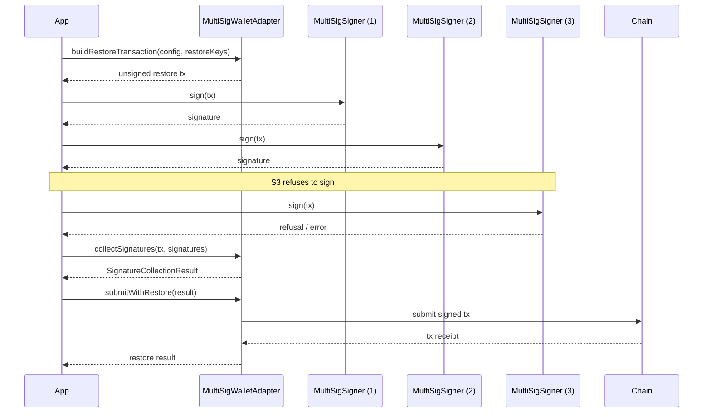

# API Reference

This document describes the public API surface of the SDK. For integration guides see
[`docs/integrations/adapters-and-wallets.md`](./integrations/adapters-and-wallets.md).

## Ledger lookup concurrency

Ledger lookups that fan out into many parallel RPC requests are bounded by a configurable
concurrency limit. This keeps large inputs from overwhelming the RPC endpoint while
preserving the order of results.

### `LedgerLookupOptions`

```ts
type LedgerLookupOptions = {
  /**
   * Maximum number of parallel RPC requests issued for a ledger lookup.
   * Defaults to `DEFAULT_LEDGER_LOOKUP_CONCURRENCY` when omitted.
   * Must be a positive integer; values below 1 are rejected.
   */
  concurrency?: number;
};
```

### `DEFAULT_LEDGER_LOOKUP_CONCURRENCY`

The default concurrency limit applied when `concurrency` is not provided. It is a stable,
exported constant so callers can reference the same value the SDK uses.

### Behaviour

- At most `concurrency` RPC requests are in flight at any time; the rest are queued.
- Results are returned in the **same order** as the input keys, regardless of the order in
  which individual requests complete.
- No results are dropped: every input key produces exactly one result (or a recorded
  failure), even for inputs far larger than the concurrency limit.
- If a request fails, the failure is surfaced for that key without discarding the results
  already collected for other keys.

### Worked example

```ts
import {
  getLedgerEntries,
  DEFAULT_LEDGER_LOOKUP_CONCURRENCY,
} from "@sdk/ledger";

// Bound parallel RPC requests for a large set of keys.
const entries = await getLedgerEntries(keys, {
  concurrency: 8,
});

// Or rely on the documented default.
const defaulted = await getLedgerEntries(keys, {
  concurrency: DEFAULT_LEDGER_LOOKUP_CONCURRENCY,
});
```

### Compatibility and migration

`concurrency` is optional and additive. Existing callers that omit it keep working and
receive the default limit; no migration is required. Callers that previously issued
unbounded parallel requests can set `concurrency` to match their RPC endpoint's capacity.

## Ledger read coalescing

Concurrent identical ledger reads issued within the same request scope are coalesced into a
single underlying read. This avoids redundant RPC round-trips when several parts of a request
ask for the same ledger key at the same time.

### `coalesceLedgerReads`

```ts
function coalesceLedgerReads<T>(
  scope: LedgerReadScope,
  key: string,
  read: () => Promise<T>,
): Promise<T>;
```

`coalesceLedgerReads` deduplicates in-flight reads by a stable `key` within a
`LedgerReadScope`. The first call for a key starts the underlying `read`; concurrent calls for
the same key in the same scope share its result instead of issuing another read.

### `LedgerReadScope`

A `LedgerReadScope` bounds the lifetime of coalesced reads. Create one per request (or per
logical unit of work) so that sharing never leaks across unrelated requests:

```ts
import { createLedgerReadScope, coalesceLedgerReads } from "@sdk/ledger";

const scope = createLedgerReadScope();

// Both calls share a single underlying read.
const [a, b] = await Promise.all([
  coalesceLedgerReads(scope, ledgerKey, () => rpc.getLedgerEntries([ledgerKey])),
  coalesceLedgerReads(scope, ledgerKey, () => rpc.getLedgerEntries([ledgerKey])),
]);
```

### Behaviour

- Identical in-flight reads (same `key`, same `scope`) share one underlying read.
- Once a read settles, its entry is evicted from the scope, so later calls perform a fresh
  read rather than returning a stale cached value.
- **Failures do not poison later calls:** if the underlying read rejects, the in-flight entry
  is evicted and the rejection is propagated to every caller sharing it. A subsequent call for
  the same key starts a new read and can succeed.
- Coalescing is scoped: reads in different scopes are never shared.

### Compatibility and migration

Coalescing is opt-in and additive. Existing direct ledger reads are unaffected; callers opt in
by wrapping reads with `coalesceLedgerReads` inside a per-request `LedgerReadScope`. Because
entries are evicted on settle, coalescing never changes read freshness semantics — it only
collapses concurrent duplicates.

## MultiSig restore

N-of-M restore support is provided by `MultiSigWalletAdapter`, `MultiSigSigner`,
`MultiSigConfig`, and `SignatureCollectionResult`. The flow is **collect-then-submit**: build a
restore transaction, collect signatures from each signer, then submit the fully signed
transaction.

### Sequence diagram



### Composing with `submitWithRestore` and `restoreKeys`

- `restoreKeys` are the keys being restored; they are passed when building the restore
  transaction and are not required again at submit time.
- `submitWithRestore` accepts the `SignatureCollectionResult` produced by
  `collectSignatures` and submits it once the threshold is met. It does not re-collect
  signatures, so a partial collection can be resumed and submitted later.

### Worked 2-of-3 example

```ts
import {
  MultiSigWalletAdapter,
  MultiSigConfig,
  MultiSigSigner,
} from "@sdk/wallets";

const config: MultiSigConfig = {
  threshold: 2,
  signers: [signerA, signerB, signerC],
};

const adapter = new MultiSigWalletAdapter(config);

// 1. Build the restore transaction for the keys being restored.
const tx = await adapter.buildRestoreTransaction({ restoreKeys });

// 2. Collect signatures from each signer (2 of 3 required).
const signatures = [];
for (const signer of [signerA, signerB]) {
  signatures.push(await signer.sign(tx));
}

const result = await adapter.collectSignatures(tx, signatures);

// 3. Submit once the threshold is met.
const receipt = await adapter.submitWithRestore(result);
```

### Failure handling for a refusing signer

If a signer refuses (throws or returns an error), `collectSignatures` records the failure in
the returned `SignatureCollectionResult` rather than aborting the whole flow. As long as the
number of successful signatures still meets `config.threshold`, the result can be passed to
`submitWithRestore`. If the threshold is not met, `submitWithRestore` rejects and the partial
result can be retained to collect the remaining signatures later.

### Types

| Type | Description |
| --- | --- |
| `MultiSigWalletAdapter` | Builds restore transactions, collects signatures, and submits them. |
| `MultiSigSigner` | A single signer that produces a signature for a restore transaction. |
| `MultiSigConfig` | Threshold and signer set for an N-of-M wallet. |
| `SignatureCollectionResult` | Outcome of `collectSignatures`, including collected signatures and per-signer failures. |

## Restore cost estimation

`estimateRestoreCost(transaction)` is the read-only companion to a restore flow. It inspects a
transaction's footprint, determines whether any of its keys are archived, and returns the extra
fee a restore would incur — **without submitting anything**. Use it to show the user what a
restore will cost before they sign.

```ts
function estimateRestoreCost(transaction: Transaction): Promise<RestoreCostEstimate>;
```

### `RestoreCostEstimate`

| Field | Type | Description |
| --- | --- | --- |
| `minResourceFee` | `number` | Minimum resource fee for the restore, in stroops. |
| `multiplier` | `number` | Fee multiplier applied to the restore resources. |
| `estimatedFee` | `number` | Total estimated restore fee (`minResourceFee` scaled by `multiplier`), in stroops. |
| `archivedKeysDetected` | `LedgerKey[]` | Footprint keys found to be archived and therefore needing a restore. |
| `wouldNeedRestore` | `boolean` | `true` when at least one archived key was detected; `false` when no restore is required. |

### Zero-fee behaviour (`wouldNeedRestore: false`)

When none of the transaction's footprint keys are archived, `wouldNeedRestore` is `false` and
`estimatedFee` is `0` (with `archivedKeysDetected` empty). In that case no restore is needed and
the transaction can be submitted as-is — you should not add the estimated fee to the user's
cost, and you can skip the restore confirmation entirely.

### Worked example: confirm the cost before signing

```ts
import { estimateRestoreCost } from "@sdk/restore";

const estimate = await estimateRestoreCost(tx);

if (estimate.wouldNeedRestore) {
  // Show the extra cost to the user before they sign.
  const feeXlm = estimate.estimatedFee / 10_000_000;
  const confirmed = await ui.confirm(
    `This transaction needs a restore of ${estimate.archivedKeysDetected.length} ` +
      `archived key(s) and will cost an extra ${feeXlm} XLM. Continue?`,
  );
  if (!confirmed) return;
} else {
  // No archived keys: no restore, no extra fee.
  console.log("No restore needed; submitting as-is.");
}

// Proceed to sign and submit only after the user has seen the cost.
const signed = await signer.sign(tx);
await submit(signed);
```

See the [fee-model guide](./guide/fees.md) and the [TTL guides](./guide/ttl.md) for how restore
fees fit into the overall fee model and TTL management.

## Contract and account scanning

The scanning APIs answer "what in my contract or account is about to expire?" **without
submitting a transaction**. They are read-only and safe to call from any client.

### `getExpiringEntriesForContract`

Scans a contract's entries and returns the ones who

/* … truncated 2012 chars — edit only what you need near the top … */
