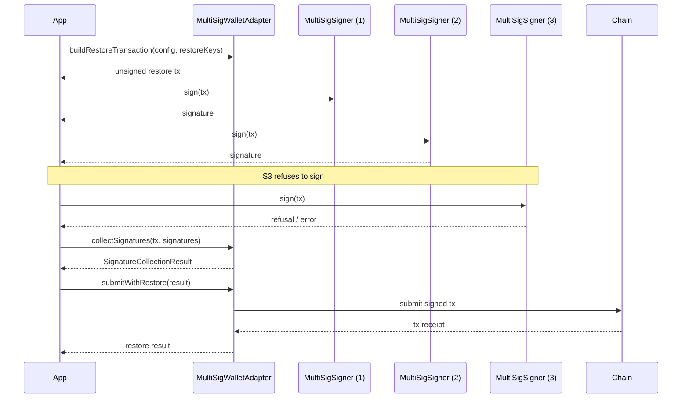
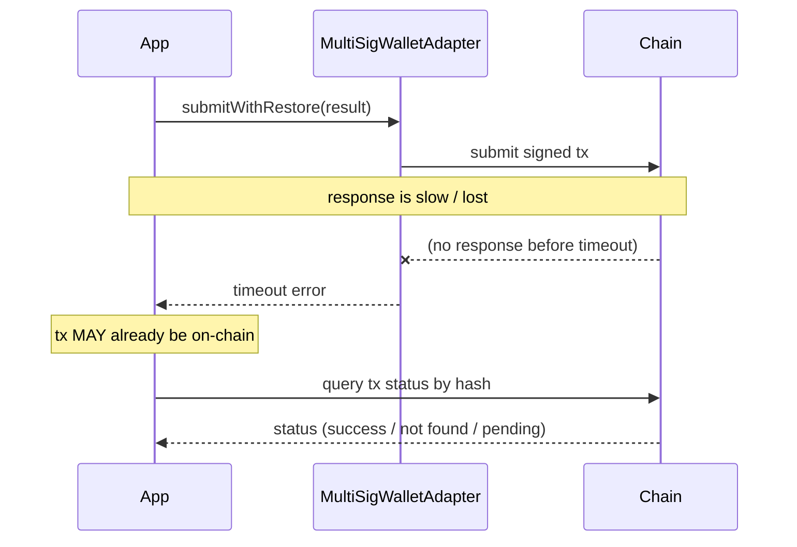
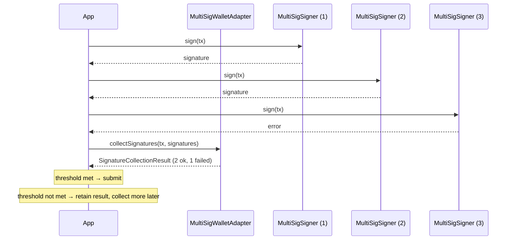
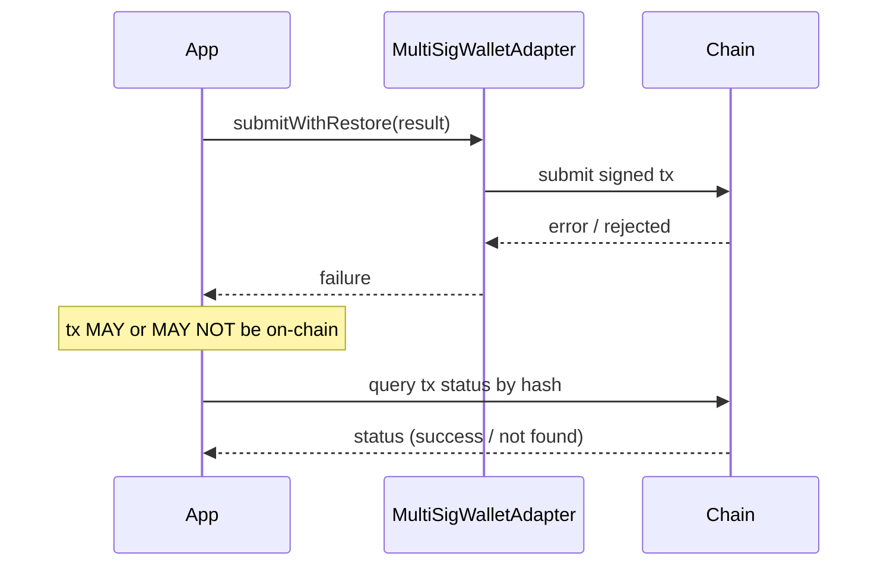

# API Reference

This document describes the public API surface of the SDK. For integration guides see
[`docs/integrations/adapters-and-wallets.md`](./integrations/adapters-and-wallets.md).

## Cached RPC reads: invalidation and freshness

Read-only RPC helpers (account, contract data, and TTL lookups) are cached to reduce
round-trips. Because ledger state is mutable, the cache exposes explicit controls so callers
can avoid stale network and TTL information.

### `CachePolicy`

```ts
type CachePolicy = {
  /** Maximum age (ms) a cached entry may be served before it is refetched. */
  ttlMs?: number;
  /** When true, bypass the cache and refetch, then store the fresh result. */
  forceRefresh?: boolean;
};
```

- `ttlMs` defaults to `DEFAULT_CACHE_TTL_MS`. Set it to `0` to disable caching for a call.
- `forceRefresh` takes precedence over `ttlMs`: the entry is always refetched.

### `invalidateCache`

```ts
function invalidateCache(keys?: CacheKey | CacheKey[]): void;
```

Drops cached entries. With no argument, the entire cache is cleared. Pass one or more
`CacheKey`s to invalidate only those entries (e.g. after submitting a transaction that
mutates a contract's data).

### Passing a policy to a read

```ts
import { getContractData, invalidateCache } from "@sdk/rpc";

// Serve from cache for up to 5s.
const data = await getContractData(contractId, { cache: { ttlMs: 5_000 } });

// After a mutation, drop the affected entry so the next read is fresh.
invalidateCache({ kind: "contractData", contractId });

// Or force a refetch for a single call without touching the cache policy.
const fresh = await getContractData(contractId, { cache: { forceRefresh: true } });
```

### Compatibility notes

- `cache` is optional; omitting it preserves the previous default caching behaviour.
- `invalidateCache` is additive and safe to call at any time; it never throws for unknown keys.
- TTL information returned by reads reflects the value at fetch time. Use `forceRefresh` when
  you need the current TTL rather than a cached one.

## MultiSig restore

N-of-M restore support is provided by `MultiSigWalletAdapter`, `MultiSigSigner`,
`MultiSigConfig`, and `SignatureCollectionResult`. The flow is **collect-then-submit**: build a
restore transaction, collect signatures from each signer, then submit the fully signed
transaction.

### Sequence diagram



### Composing with `submitWithRestore` and `restoreKeys`

- `restoreKeys` are the keys being restored; they are passed when building the restore
  transaction and are not required again at submit time.
- `submitWithRestore` accepts the `SignatureCollectionResult` produced by
  `collectSignatures` and submits it once the threshold is met. It does not re-collect
  signatures, so a partial collection can be resumed and submitted later.

### Worked 2-of-3 example

```ts
import {
  MultiSigWalletAdapter,
  MultiSigConfig,
  MultiSigSigner,
} from "@sdk/wallets";

const config: MultiSigConfig = {
  threshold: 2,
  signers: [signerA, signerB, signerC],
};

const adapter = new MultiSigWalletAdapter(config);

// 1. Build the restore transaction for the keys being restored.
const tx = await adapter.buildRestoreTransaction({ restoreKeys });

// 2. Collect signatures from each signer (2 of 3 required).
const signatures = [];
for (const signer of [signerA, signerB]) {
  signatures.push(await signer.sign(tx));
}

const result = await adapter.collectSignatures(tx, signatures);

// 3. Submit once the threshold is met.
const receipt = await adapter.submitWithRestore(result);
```

### Failure handling for a refusing signer

If a signer refuses (throws or returns an error), `collectSignatures` records the failure in
the returned `SignatureCollectionResult` rather than aborting the whole flow. As long as the
number of successful signatures still meets `config.threshold`, the result can be passed to
`submitWithRestore`. If the threshold is not met, `submitWithRestore` rejects with a
`THRESHOLD` category error and the partial result can be retained to collect the remaining
signatures later.

### Types

| Type | Description |
| --- | --- |
| `MultiSigWalletAdapter` | Builds restore transactions, collects signatures, and submits them. |
| `MultiSigSigner` | A single signer that produces a signature for a restore transaction. |
| `MultiSigConfig` | Threshold and signer set for an N-of-M wallet. |
| `SignatureCollectionResult` | Outcome of `collectSignatures`, including collected signatures and per-signer failures. |

## Timeout and partial-failure scenarios

Restore flows can fail or time out at several points. Because a restore may already have
been submitted to the network when a timeout or error surfaces, an application must know
**which actions may already have occurred** before it retries or reports failure. The
diagrams below document those outcomes and how to reconcile status.

### Timeout while submitting

A timeout on `submitWithRestore` does **not** mean the restore did not happen. The signed
transaction may already have been accepted by the network.



**What may already have occurred:** the signed transaction may have been broadcast and
included in a ledger. The restore itself may have completed even though the caller saw a
timeout.

**How to reconcile:** do not blindly resubmit. Query the transaction status by its hash
first. If it succeeded, treat the restore as complete. If it is not found, it is safe to
resubmit the same signed transaction. If it is still pending, wait and re-check.

### Partial failure during signature collection

A signer can fail or refuse while others succeed. `collectSignatures` records per-signer
failures instead of aborting, so the flow can continue when the threshold is still met.



**What may already have occurred:** successful signatures have been collected; no
on-chain action has happened yet. Nothing is submitted until `submitWithRestore` is called.

**How to reconcile:** inspect the `SignatureCollectionResult`. If the successful count
meets `config.threshold`, submit. Otherwise retain the partial result and collect the
remaining signatures before submitting — no on-chain state needs to be undone.

### Failure after submission

If `submitWithRestore` rejects with a non-timeout error after the transaction was sent,
the transaction may still have been included.



**What may already have occurred:** the transaction may have been included before the
error was observed, or it may have been rejected outright.

**How to reconcile:** query the transaction status by hash. If it succeeded, the restore
is complete. If it is not found, the transaction was not applied and the flow can be
retried (re-collecting signatures if the transaction changed).

### Reconciliation checklist

- Always keep the signed transaction hash so you can query its status after a timeout or
  failure.
- Never assume a timeout means the restore did not happen — check the chain first.
- Only resubmit the **same** signed transaction when the status query reports it was not
  found; otherwise you risk a duplicate submission.
- A partial `SignatureCollectionResult` is safe to retain and resume; it has no on-chain
  effect until submitted.

## Restore cost estimation

`estimateRestoreCost(transaction)` is the read-only companion to a restore flow. It inspects a
transaction's footprint, determines whether any of its keys are archived, and returns the extra
fee a restore would incur — **without submitting anything**. Use it to show the user what a
restore will cost before they sign.

```ts
function estimateRestoreCost(transaction: Transaction): Promise<RestoreCostEstimate>;
```

### `RestoreCostEstimate`

| Field | Type | Description |
| --- | --- | --- |
| `minResourceFee` | `number` | Minimum resource fee for the restore, in stroops. |
| `multiplier` | `number` | Fee multiplier applied to the restore resources. |
| `estimatedFee` | `number` | Total estimated restore fee (`minResourceFee` scaled by `multiplier`), in stroops. |
| `archivedKeysDetected` | `LedgerKey[]` | Footprint keys found to be archived and therefore needing a restore. |
| `wouldNeedRestore` | `boolean` | `true` when at least one archived key was detected; `false` when no restore is required. |

### Zero-fee behaviour (`wouldNeedRestore: false`)

When none of the transaction's footprint keys are archived, `wouldNeedRestore` is `false` and
`estimatedFee` is `0` (with `archivedKeysDetected` empty). In that case no restore is needed and
the transaction can be submitted as-is — you should not add the estimated fee to the user's
cost, and you can skip the restore confirmation entirely.

### Worked example: confirm the cost before signing

```ts
import { estimateRestoreCost } from "@sdk/restore";

const estimate = await estimateRestoreCost(tx);

if (estimate.wouldNeedRestore) {
  // Show the extra cost to the user before they sign.
  const feeXlm = estimate.estimatedFee / 10_000_000;
  const confirmed = await ui.confirm(
    `This transaction needs a restore of ${estimate.archivedKeysDetected.length} ` +
      `archived key(s) and will cost an extra ${feeXlm} XLM. Continue?`,
  );
  if (!confirmed) return;
} else {
  // No archived keys: no restore, no extra fee.
  console.log("No restore needed; submitting as-is.");
}

// Proceed to sign and submit only after the user has seen the cost.
const signed = await signer.sign(tx);
await submit(signed);
```

See the [fee-model guide](./guide/fees.md) and the [TTL guides](./guide/ttl.md) for how restore
fees fit into the overall fee model and TTL management.

## Large footprint processing

Footprint processing (e.g. scanning a transaction's footprint for archived keys) can be
expensive for large footprints. To avoid blocking the UI thread, the SDK exposes a chunked,
yielding processor alongside the existing synchronous behaviour. Output ordering and results
are **deterministic** and identical to the synchronous path — chunking only affects *when*
work runs, not *what* it produces.

```ts
type FootprintChunkOptions = {
  /** Number of footprint keys processed per chunk. Defaults to `DEFAULT_FOOTPRINT_CHUNK_SIZE`. */
  chunkSize?: number;
  /**
   * Yields control back to the event loop between chunks. Defaults to a macrotask
   * (`setTimeout(…, 0)`) so the UI thread can paint. Pass a custom scheduler to
   * integrate with your own runtime (e.g. `requestIdleCallback`).
   */
  yieldTo?: () => Promise<void>;
};

function processFootprintChunked<T, R>(
  items: readonly T[],
  process: (item: T, index: number) => R,
  options?: FootprintChunkOptions,
): Promise<R[]>;
```

- Results are returned in the same order as the input `items`, regardless of `chunkSize`.
- An empty `items` array resolves immediately with `[]` without yielding.
- A `chunkSize` of `0` or a negative value is rejected with a `RangeError`.
- Errors thrown by `process` reject the returned promise; already-processed chunks are
  discarded (no partial result is returned).
- `DEFAULT_FOOTPRINT_CHUNK_SIZE` is the default chunk size used when `chunkSize` is omitted.

### Worked example: chunked footprint scan

```ts
import { processFootprintChunked } from "@sdk/restore";

// `footprintKeys` may be very large; process it in chunks so the UI stays responsive.
const archived = await processFootprintChunked(
  footprintKeys,
  (key) => isArchived(key),
  { chunkSize: 256 },
);
```

> **Compatibility note:** the synchronous processing path is unchanged and remains the
default for small footprints. Adopt `processFootprintChunked` when footprints may be large
or when running on a UI thread. Because output is deterministic, switching between the sync
and chunked paths does not change results.

## Contract and account scanning

The scanning APIs answer "what in my contract or account is about to expire?" **without
submitting a transaction**. They are read-only and safe to call from any client.

### `getExpiringEntriesForContract`

Scans a contract's entries and returns the ones whose TTL is at or below the configured
threshold.

```ts
type ContractScanOptions = {
  /** Ledger offset below which an entry is considered "expiring soon". */
  expiringSoonLedgers?: number;
  /** Instance entry to scan, if any. */
  instance?: LedgerKey;
  /** Wasm code entry to scan, if any. */
  wasmCode?: LedgerKey;
  /** Storage keys to scan. */
  storageKeys?: LedgerKey[];
};

type ContractScanResult = {
  instance?: ClassicEntryStatus;
  wasmCode?: ClassicEntryStatus;
  storage: ClassicEntryStatus[];
};

type ClassicEntryStatus = {
  key: LedgerKey;
  liveUntilLedger: number;
  expiringSoon: boolean;
};

function getExpiringEntriesForContract(
  contractId: string,
  options?: ContractScanOptions,
): Promise<ContractScanResult>;
```

> **Important limitation:** a contract's storage keys **cannot be enumerated** from the
> ledger. You must supply the storage keys you care about via `options.storageKeys`.
> Only the instance and wasm code entries can be discovered automatically. If you omit
> `storageKeys`, the result's `storage` array will be empty.

`DEFAULT_EXPIRING_SOON_LEDGERS` is the default threshold used when `expiringSoonLedgers`
is not provided.

### `getExpiringEntriesForAccount`

Scans an account's presence and trustline entries. This is a **presence scan**, not a TTL
scan: it reports whether the account and its trustlines exist, separately from any TTL
information.

```ts
type AccountScanOptions = {
  /** Trustline asset keys to check for presence. */
  trustlines?: LedgerKey[];
};

function getExpiringEntriesForAccount(
  accountId: string,
  options?: AccountScanOptions,
): Promise<ContractScanResult>;
```

### Worked example: instance, wasm code, and storage keys

```ts
import {
  getExpiringEntriesForContract,
  getExpiringEntriesForAccount,
  DEFAULT_EXPIRING_SOON_LEDGERS,
} from "@sdk/scanning";

// Contract scan: instance + wasm code are discovered automatically, but storage
// keys

/* … truncated 1239 chars — edit only what you need near the top … */
