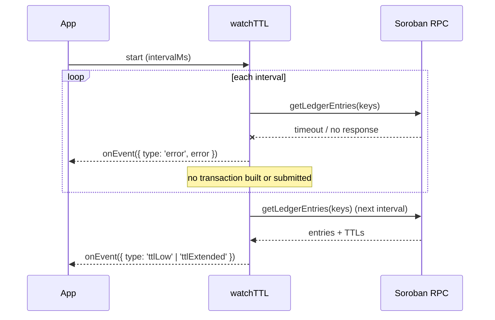
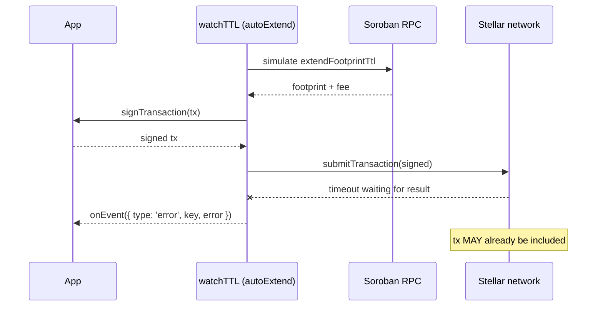
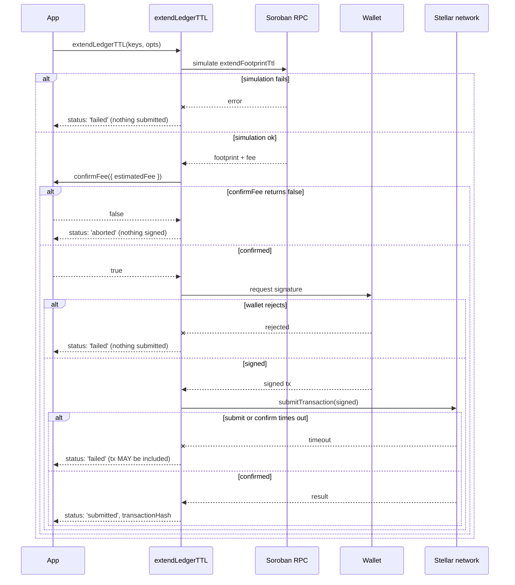

# Proactive TTL Watch & Extend

Soroban ledger entries have a time-to-live (TTL). When an entry's TTL drops to
zero the entry is archived and any transaction that touches it must restore it
first. Instead of reacting to archives after the fact, you can watch an entry's
TTL and extend it _before_ it expires.

The SDK exposes this through `watchTTL`, which polls the ledger for a set of
keys and, optionally, automatically extends them when they fall below a
threshold.

## Obtaining ledger keys

`watchTTL` operates on `LedgerKey` values. You can build them by hand, or — more
commonly — extract them from a transaction's footprint using the same helpers
the restore flow uses:

```typescript
import { SorobanResurrect, extractFootprintFromSuccess } from '@soroban-resurrect/sdk'

const sr = new SorobanResurrect({ rpcUrl: 'https://soroban-testnet.stellar.org' })

// Simulate the transaction you care about and pull the keys it reads/writes.
const sim = await sr.simulate(transaction)
const keys = extractFootprintFromSuccess(sim)
```

If you already know the contract data keys you want to protect, construct them
directly with `xdr.LedgerKey.contractData(...)` and pass them in.

## Query TTL and lifecycle status

Use `queryLedgerTTL` to get a snapshot with a stable status for each requested
key. The default `warningWindowLedgers` is 100; keys with a positive TTL at or
below that window are `near-expiry`. Override the window per query:

```typescript
const result = await sr.queryLedgerTTL(keys, { warningWindowLedgers: 17_280 })

for (const entry of result.entries) {
  switch (entry.status) {
    case 'healthy':
      break
    case 'near-expiry':
      showWarning(`${entry.ttlLedgers} ledgers remain`)
      break
    case 'archived':
      showRestoreAction(entry.keyBase64)
      break
    case 'unknown':
      // The RPC request failed or returned incomplete TTL data; retry rather
      // than treating the key as archived.
      break
  }
}
```

`result.hasErrors` and `result.failedChunks` describe failed ledger-entry RPC
requests. Entries in those chunks have `status: 'unknown'` and are not returned
by `getExpiringSoonEntries`, so a transient RPC failure cannot trigger an
unnecessary restore. Missing entries from a successful response are reported
as `archived`. Existing callers can continue using `isArchived`; it is false
for both `healthy`, `near-expiry`, and `unknown` entries.

## Cache invalidation and freshness

`queryLedgerTTL` results are cached so repeated polls do not hammer the RPC.
Because TTLs are mutable, the cache is bounded by a freshness policy rather
than trusted indefinitely. Two controls let you avoid stale network and TTL
data:

- `maxAgeMs` — the maximum age (in milliseconds) a cached read may have before
  it is considered stale and re-fetched. Defaults to **5000 ms**.
- `bypassCache` — when `true`, the read skips the cache entirely, fetches fresh
  data from the RPC, and refreshes the cache with the result.

```typescript
// Accept cached data only if it is at most 2 seconds old.
const fresh = await sr.queryLedgerTTL(keys, { maxAgeMs: 2000 })

// Force a fresh read, e.g. right before submitting an extend transaction.
const forced = await sr.queryLedgerTTL(keys, { bypassCache: true })
```

### Invalidating cached reads

When you know the underlying state changed (for example, after you submit an
extend or restore transaction), invalidate the affected keys so the next read
is guaranteed fresh. `invalidateTTLCache` accepts the same keys you queried;
pass no argument to clear the entire TTL cache:

```typescript
// Invalidate specific keys after an extend/restore.
await sr.extendLedgerTTL(keys, { wallet, extendTo: 200_000, confirmFee })
sr.invalidateTTLCache(keys)

// Or drop everything (e.g. after switching networks).
sr.invalidateTTLCache()
```

`watchTTL` uses the same cache and freshness policy. Pass `maxAgeMs` and
`bypassCache` through the watch options to control how fresh each poll is; the
watcher also invalidates a key's cache entry automatically after it applies an
extension, so the next poll observes the new TTL instead of a stale value.

```typescript
const handle = sr.watchTTL({
  keys,
  thresholdLedgers: 2000,
  maxAgeMs: 1000, // treat cached TTLs older than 1s as stale
  autoExtend: true,
  sourcePublicKey: keypair.publicKey(),
  signTransaction: async (tx) => {
    tx.sign(keypair)
    return tx
  },
})
```

### Compatibility notes

- `maxAgeMs` and `bypassCache` are optional; existing calls to
  `queryLedgerTTL` and `watchTTL` keep their previous behavior, with the cache
  now bounded by the default 5s freshness window.
- `invalidateTTLCache` is additive and safe to call at any time; it never
  throws for unknown keys.
- Setting `maxAgeMs: 0` is equivalent to `bypassCache: true` for that read.

## Choosing `thresholdLedgers`

`thresholdLedgers` is the number of ledgers remaining before the watcher
considers a key "low" and fires `ttlLow` (and, in auto-extend mode, extends it).

- Too low and you risk the entry archiving between polls.
- Too high and you pay to extend entries far earlier than necessary.

A good starting point is a few thousand ledgers — enough headroom to survive a
poll interval plus some slack. The default is **1000 ledgers**.

## Observe-only mode

By default the watcher only reports. It emits `ttlLow` when a key crosses the
threshold and `ttlExtended` when a key's TTL is observed to have increased, but
it never submits a transaction:

```typescript
const handle = sr.watchTTL({
  keys,
  thresholdLedgers: 2000,
  onEvent: (event) => {
    if (event.type === 'ttlLow') {
      console.warn(`key ${event.key} is low: ${event.remainingLedgers} ledgers left`)
    }
    if (event.type === 'ttlExtended') {
      console.log(`key ${event.key} extended to ${event.remainingLedgers} ledgers`)
    }
  },
})

// Later, when you no longer need to watch:
handle.stop()
```

## Auto-extend mode

Set `autoExtend: true` to have the watcher build, sign, and submit an extend
operation whenever a key falls below the threshold. You must supply a signer and
the source account:

```typescript
const handle = sr.watchTTL({
  keys,
  thresholdLedgers: 2000,
  autoExtend: true,
  sourcePublicKey: keypair.publicKey(),
  signTransaction: async (tx) => {
    tx.sign(keypair)
    return tx
  },
  onEvent: (event) => {
    if (event.type === 'ttlExtended') {
      console.log(`extended ${event.key} to ${event.remainingLedgers} ledgers`)
    }
  },
})
```

## The event contract

`onEvent` receives a discriminated union:

| `event.type`  | Fields                    | Meaning                                              |
| ------------- | ------------------------- | ---------------------------------------------------- |
| `ttlLow`      | `key`, `remainingLedgers` | A watched key dropped below `thresholdLedgers`.      |
| `ttlExtended` | `key`, `remainingLedgers` | A watched key's TTL increased (observed or applied). |
| `error`       | `key?`, `error`           | A poll or extend attempt failed.                     |

## Interval and threshold defaults

The watcher polls every **30 seconds** (`intervalMs`) and treats a key as low
below **1000 ledgers** (`thresholdLedgers`). Override either per call:

```typescript
const handle = sr.watchTTL({
  keys,
  intervalMs: 10_000, // poll every 10s
  thresholdLedgers: 5000, // extend earlier
  autoExtend: true,
  sourcePublicKey: keypair.publicKey(),
  signTransaction: async (tx) => {
    tx.sign(keypair)
    return tx
  },
})
```

## Explicitly extend selected entries

For an on-demand TTL extension, use `extendLedgerTTL`. It accepts only
persistent contract-data and contract-code keys, simulates an
`extendFootprintTtl` transaction, and passes the fee estimate to your
confirmation callback **before** prompting the wallet. Returning `false`
aborts without signing or submitting.

```typescript
const result = await sr.extendLedgerTTL(keys, {
  wallet,
  extendTo: 200_000, // minimum total TTL in ledgers, not an increment
  confirmFee: async ({ keyCount, extendTo, estimatedFee }) =>
    confirm({
      title: 'Extend contract state',
      message: `Extend ${keyCount} entries to ${extendTo} ledgers for ${estimatedFee} stroops?`,
    }),
})

if (result.status === 'submitted') {
  console.log('Extension transaction:', result.transactionHash)
}
```

After the application confirms the estimate, the wallet is asked to sign the
transaction. Temporary contract data and non-contract ledger keys are rejected.
Use `queryLedgerTTL` first when you need to inspect current TTLs or exclude keys
that are already missing.

## Stopping the watcher

`watchTTL` returns a handle. Call `handle.stop()` to clear the polling timer and
release the watcher. After `stop()` no further events are emitted.

```typescript
const handle = sr.watchTTL({ keys })
// ...
handle.stop()
```

## Timeout and partial-failure scenarios

Watching and extending TTLs involves several network round-trips: polling the
ledger, simulating the extend transaction, submitting it, and waiting for the
result. Any of these can time out or fail partway through. The diagrams below
show **which actions may already have occurred** when a timeout or failure is
returned, so your application knows what state to reconcile against.

### Timeout during a poll

A poll timeout happens before any transaction is built, so no on-chain state
changes. The watcher simply retries on the next interval.



**Actions that may have occurred:** none on-chain. The only side effect is the
emitted `error` event. Reconcile by treating the key's status as `unknown`
until the next successful poll — do **not** assume the entry is archived.

### Timeout during an auto-extend submission

This is the ambiguous case. The extend transaction may have been submitted and
included in a ledger even though the watcher never received a confirmation.



**Actions that may have occurred:** the transaction may have been signed and
submitted, and may already be included in a ledger. The watcher does not retry
the submission itself; it re-polls on the next interval.

**How to reconcile:**

1. Re-query the key with `queryLedgerTTL`. If the TTL increased, the extension
   succeeded — no further action is needed.
2. If the TTL is unchanged, the transaction was not included. It is safe to
   extend again on the next `ttlLow` event.
3. If the status is `unknown` (the re-query itself failed), wait for the next
   poll rather than resubmitting blindly. Extending an already-extended entry is
   idempotent in effect (it sets a minimum total TTL), but avoid duplicate
   submissions within the same interval.

### Partial failure in `extendLedgerTTL`

`extendLedgerTTL` is a single explicit call. Its `result.status` tells you how
far it got, and each terminal status maps to a distinct set of actions that may
have occurred.



**Reconciling by status:**

| `result.status` | Actions that may have occurred              | Reconciliation                                              |
| --------------- | ------------------------------------------- | ----------------------------------------------------------- |
| `aborted`       | Nothing signed or submitted.                | Safe to retry with a new estimate.                          |
| `failed`        | Depends on the stage — see below.           | Re-query TTL before retrying.                               |
| `submitted`     | Transaction included; `transactionHash` set. | None; the extension is applied.                             |

For a `failed` result, distinguish the stage from the error:

- **Simulation or wallet failure:** nothing was submitted. Retry is safe.
- **Submission/confirmation timeout:** the transaction may already be included.
  Re-query the key with `queryLedgerTTL` and only retry if the TTL did not
  increase. Because `extendTo` is a minimum total TTL (not an increment),
  re-extending an already-extended entry is harmless.

### General reconciliation rule

After any timeout or failure, treat the outcome as **unknown** until you have
re-queried the affected keys. Never assume a timeout means the action did not
happen, and never assume it did. `queryLedgerTTL` is the source of truth: a
higher TTL means the extension landed; an unchanged TTL means it did not.
